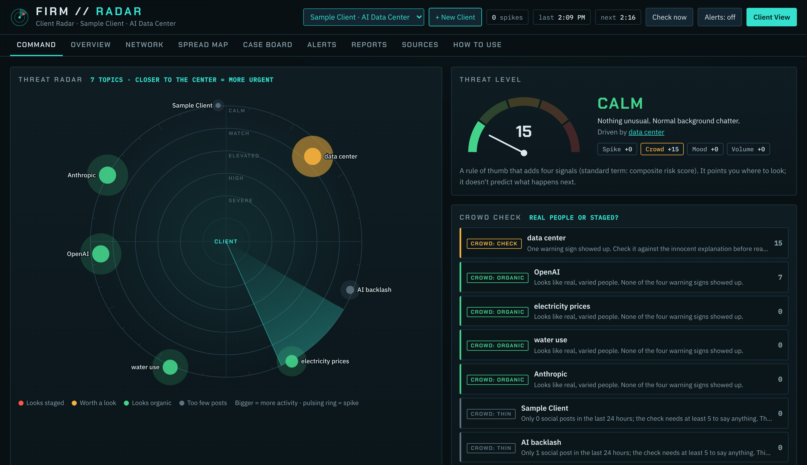
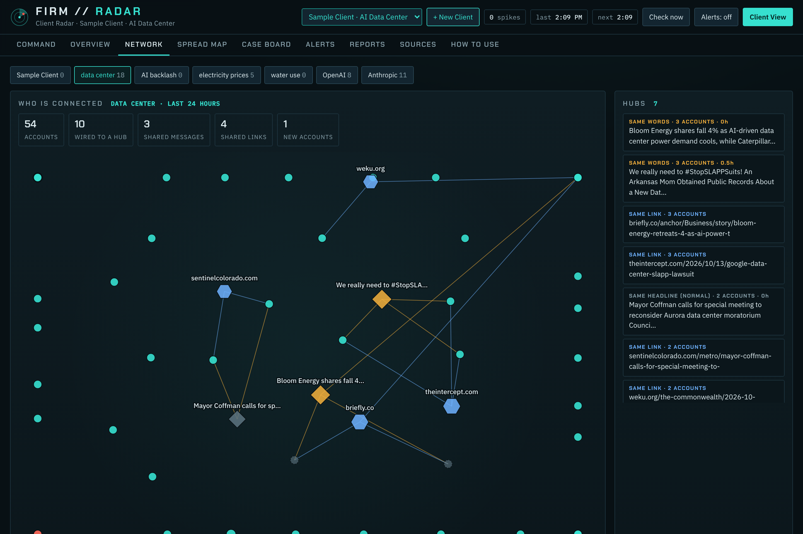
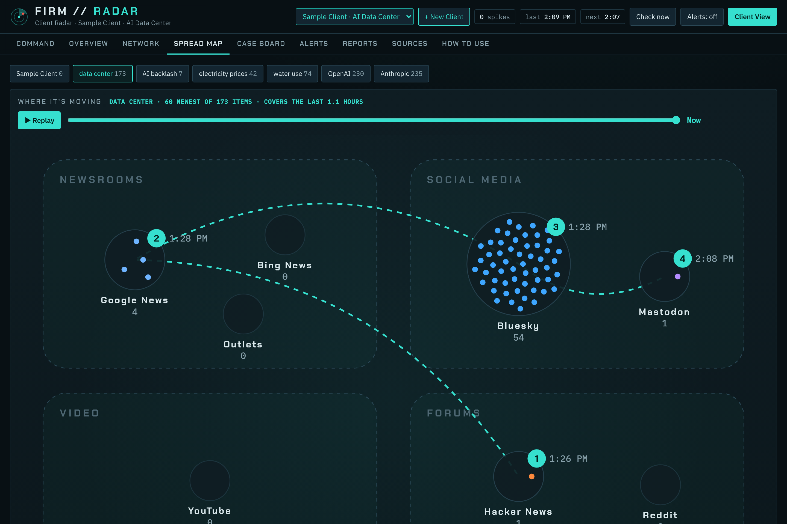
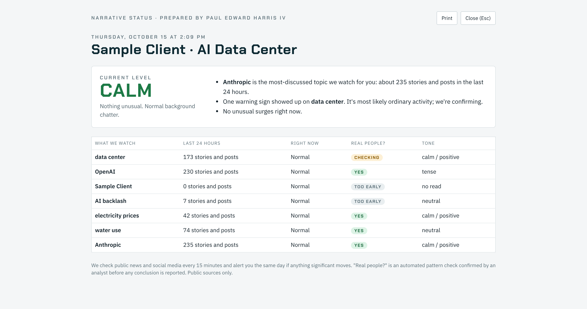

# Firm Radar

**A private narrative-intelligence operations room for each client.**
Firm Radar monitors the stories around a person, company or campaign, checks whether a surge looks like real people or a staged crowd, maps who is connected and where a story is spreading, and writes a weekly brief with confidence levels.

*Screenshots use real public data from a test run with a sample client. Account names on the network map are hidden.*

## What it does

- **Command view.** A threat radar puts the client at the center and every topic as a blip: the closer to the center, the more urgent. Color shows the crowd check, size shows volume, a pulsing ring marks a spike. Next to it: a 0–100 threat meter (a composite risk score built from spike, crowd, mood and volume signals, with the breakdown shown), a live feed, a 48-hour pulse and what to watch next.
- **Crowd check (coordinated inauthentic behavior detection).** Looks for four warning signs: near-identical wording across many accounts, a burst of brand-new accounts (compared with the round's baseline), one link pushed hard within an hour, and a few accounts doing most of the talking. Each sign comes with the innocent explanation to rule out. News-headline sharing, wire syndication, cross-posting and labeled news-bot accounts are recognized and don't count. It finds patterns, not proof: an analyst checks the accounts by hand before anything is reported.
- **Network view.** Accounts linked to the messages and links they share (a bipartite network graph). A loose cloud is normal; a tight star of new accounts around one message is the pattern to check.
- **Spread Map.** Where a story appeared (newsrooms, social media, forums, video, code), in what order, with a replay.
- **Client View.** A clean, light screen to share on a call, with no account names, notes or evidence links.
- **Weekly brief.** One click writes the client's week up (what moved, what looked coordinated, what to watch next) with confidence levels and likelihood words following the ICD 203 standard. Edit in the browser, then print to PDF.
- **Multi-client.** Each client gets a separate folder for their watchlist, alerts, history and reports, so no client's data mixes with another's.
- **Feeds.** Paste any RSS/Atom link (Google Alerts, YouTube channel, GitHub, Bluesky profile, Substack) to watch places the search sources can't reach.

| Network | Spread Map |
| --- | --- |
|  |  |

## Run it (Windows)

1. Install Python 3.10 or newer.
2. Double-click **Start Firm Radar.bat**. The page opens at `http://localhost:8865`.
3. Click **+ New Client**, enter a name, their issues and their competitors. It starts watching right away.

It runs on your own computer, needs no API keys, and only reads public sources: GDELT, Google News, Bing News, Bluesky, Mastodon, Hacker News, Reddit, outlet and YouTube feeds, and any feeds you add.

## How it works

`engine/watch.py` checks every client's topics once per round (shared topics are fetched once) and files each result only into the clients that watch it (`tenants.py`). `cib.py` runs the crowd check and builds the network data. `report.py` writes the weekly brief from each client's saved history. `server.py` serves the page (`app.html`) on localhost.

## Status and limits

Working prototype (v0.1). It sees public sources only: X, LinkedIn, Facebook, Instagram and TikTok don't offer free search, and Reddit often blocks automated access. Automated coordination findings are never rated High confidence by themselves.

## About

Built by **Paul Edward Harris 4th** ([GitHub](https://github.com/seek-k-nowledge)) as an independent project, with heavy AI assistance (Claude) for the code.
Companion project: [Narrative Radar](https://github.com/seek-k-nowledge/narrative-radar), the podcast research version it grew out of.

## License

MIT. See [LICENSE](LICENSE).
